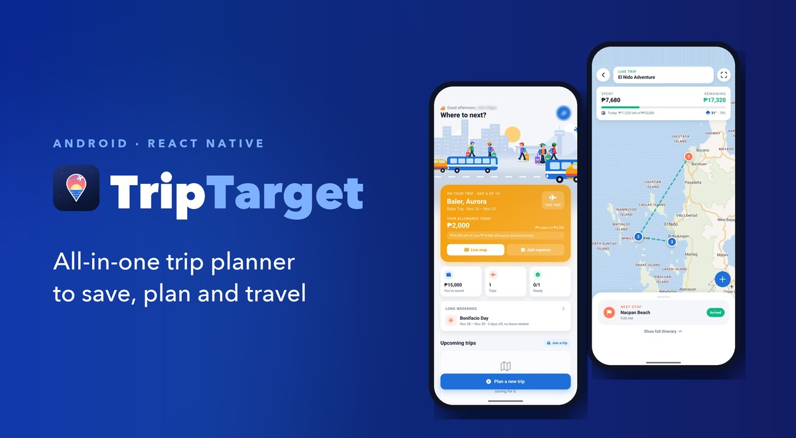

# TripTarget for Android

**Aim. Save. Go.** The all-in-one trip planner that gets you from "someday" to departure day.

[**⬇ Download the latest APK**](https://triptarget.jefbuilds.dev/download)

---

This repository hosts the Android app's installable releases. See every version and what changed on the [Releases page](https://github.com/jedgarf/TripTarget-Releases/releases).

## What TripTarget does

- Set a **savings goal** for every trip, with a plan for how much to set aside every payday
- A **checklist** with ready-made packing lists, and an **itinerary** planned on a map
- A **live trip map** with your route, today's budget and the weather
- Track **expenses** by hand, or by scanning a receipt or a payment screenshot from GCash, Maya or any bank
- **Group trips:** start a trip with friends and invite them by QR code or email. Choose a **shared group budget** or **KKB** (everyone pays their own way), keep your own allowance, chat live, and see where everyone is (even when the app is closed, if you choose)
- **Find each other with no signal:** a GPS compass to a friend's last spot and your meeting point, and call or text the group
- **A home that follows your day:** a city street that turns to dusk and night with the clock
- **Updates inside the app:** see what's new and update in a few taps, or get reminded later
- Works **offline** once you're logged in, syncs across phones, and supports fingerprint / Face ID unlock (turn it on to log back in offline; a password login needs internet)

## Requirements

- Android 7.0 or newer
- About 100 MB of free space

## Installing

1. Download **TripTarget-v&lt;version&gt;.apk** from the [latest release](https://github.com/jedgarf/TripTarget-Releases/releases/latest).
2. Open the file on your phone. If asked, allow your browser or file manager to install apps.
3. If Google Play Protect shows a warning, tap **More details → Install anyway**. It shows this for apps installed outside the Play Store.
4. Open TripTarget and create your free account.

**Updating:** from 1.17.0 on, the app tells you when a new version is out and can update itself, whenever you're ready. You can also install the new APK over the old one. Your trips stay either way, because every release is signed with the same key.

## Contact

Questions or feedback: [triptarget.jefdevsolutions@gmail.com](mailto:triptarget.jefdevsolutions@gmail.com)
